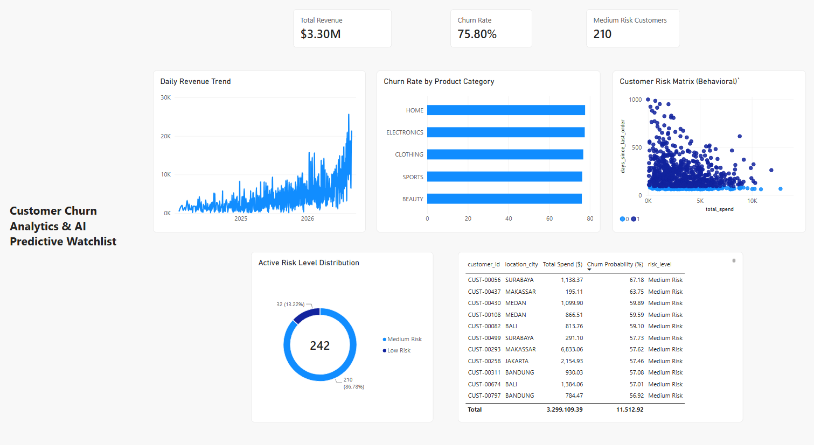

# End-to-End Customer Churn Analytics & AI Platform 🚀

An end-to-end data engineering and analytics project that automates
e-commerce data ingestion, transformation, data quality validation,
customer churn prediction, and business intelligence reporting.

The platform uses a **Medallion Architecture** in PostgreSQL,
orchestrated with Apache Airflow and transformed with dbt. It also
includes a machine learning workflow that produces customer churn-risk
probabilities for downstream analysis.

------------------------------------------------------------------------

## 📌 Project Overview

This project demonstrates how raw e-commerce transactional data can be
transformed into analytics-ready data products and used to support
customer retention analysis.

Key capabilities:

-   Automated data ingestion into a Bronze layer.
-   Data cleaning and transformation with dbt.
-   Structured Silver and Gold layers in PostgreSQL.
-   Automated data quality checks using dbt tests.
-   Customer segmentation and churn-risk prediction using a Random
    Forest classifier.
-   Power BI dashboards built on top of Gold data marts.

## 🏗️ Architecture

``` text
Raw E-commerce Datasets
          |
          v
  Python Data Ingestion
          |
          v
   PostgreSQL - BRONZE
     (Raw Tables)
          |
          v
       dbt Models
          |
          v
   PostgreSQL - SILVER
   (Staging Models)
          |
          v
       dbt Models
          |
          v
    PostgreSQL - GOLD
     (Data Marts)
       /       \
      v         v
 dbt Tests   Churn Model
                |
                v
       Churn Predictions
                |
                v
             Power BI
```

### Medallion Architecture

  ----------------------------------------------------------------------------
  Layer                   Purpose                 Example objects
  ----------------------- ----------------------- ----------------------------
  **Bronze**              Stores ingested raw     `raw_customers`,
                          source data.            `raw_orders`,
                                                  `raw_order_items`,
                                                  `raw_products`

  **Silver**              Cleans, standardizes,   `stg_customers`,
                          and prepares source     `stg_orders`,
                          data for analysis.      `stg_order_items`,
                                                  `stg_products`

  **Gold**                Contains                `mart_customer_rfm`,
                          business-oriented data  `mart_daily_revenue`,
                          marts for analytics and `mart_product_performance`
                          reporting.              
  ----------------------------------------------------------------------------

## 🧰 Tech Stack

  -----------------------------------------------------------------------
  Area                    Tools                   Purpose
  ----------------------- ----------------------- -----------------------
  Orchestration           Apache Airflow          Scheduling and
                                                  dependency management

  Containerization        Docker, Docker Compose  Running the platform
                                                  services

  Database / Data         PostgreSQL              Storing Bronze, Silver,
  Warehouse                                       and Gold data

  Data Transformation     dbt                     SQL-based
                                                  transformations and
                                                  data modeling

  Data Quality            dbt tests               Validating model data

  Data Ingestion          Python, pandas,         Loading source datasets
                          SQLAlchemy              into PostgreSQL

  Machine Learning        Python, scikit-learn,   Training and
                          pandas, joblib          serializing the churn
                                                  model

  Business Intelligence   Power BI                Visualizing business
                                                  metrics and churn
                                                  insights
  -----------------------------------------------------------------------

## 📁 Repository Structure

``` text
customer_churn_analytics_platform/
├── dags/
│   └── churn_pipeline_dag.py
├── dbt/
│   ├── macros/
│   │   └── generate_schema_name.sql
│   ├── models/
│   │   ├── gold/
│   │   │   ├── mart_customer_rfm.sql
│   │   │   ├── mart_daily_revenue.sql
│   │   │   ├── mart_product_performance.sql
│   │   │   └── schema.yml
│   │   └── silver/
│   │       ├── sources.yml
│   │       ├── stg_customers.sql
│   │       ├── stg_order_items.sql
│   │       ├── stg_orders.sql
│   │       └── stg_products.sql
│   ├── dbt_project.yml
│   └── profiles.yml
├── scripts/
│   ├── ingest_data.py
│   └── train_churn_model.py
├── docs/
│   └── dashboard_preview.png
├── dashboard_visualization.pbix
├── docker-compose.yml
├── Dockerfile
├── requirements.txt
├── .gitignore
└── README.md
```

## 🔄 Pipeline Workflow

The `end_to_end_churn_analytics_pipeline` DAG coordinates the workflow.
The main stages are:

1.  **Data ingestion --- Bronze**
    -   Loads the source e-commerce datasets into raw tables in the
        PostgreSQL `bronze` schema.
2.  **Data transformation --- Silver**
    -   Runs dbt staging models to clean and standardize source data.
    -   Prepares customer, order, order-item, and product data for
        downstream transformations.
3.  **Data modeling --- Gold**
    -   Builds analytics-ready data marts:
        -   `gold.mart_customer_rfm`: customer-level Recency, Frequency,
            and Monetary metrics.
        -   `gold.mart_daily_revenue`: daily revenue aggregations.
        -   `gold.mart_product_performance`: product-level performance
            metrics.
4.  **Data quality validation**
    -   Runs the configured dbt test suite.
    -   Tests can include constraints such as `not_null`, `unique`, and
        `accepted_values`, as defined in the dbt model YAML
        configuration.
5.  **Churn prediction**
    -   Uses customer-level RFM features to train a Random Forest
        classification model.
    -   Applies class balancing with `class_weight='balanced'`.
    -   Generates churn probabilities and assigns customer risk
        categories.
    -   Writes prediction results to `gold.mart_churn_predictions`.
    -   Serializes the trained model using joblib for reuse.
6.  **Business intelligence**
    -   The Power BI report (`dashboard_visualization.pbix`) uses
        Gold-layer data marts to present business and customer
        analytics.

## 🤖 Machine Learning Approach

The churn prediction workflow is implemented in
`scripts/train_churn_model.py`.

### Model workflow

-   **Features:** Customer RFM metrics from `gold.mart_customer_rfm`.
-   **Algorithm:** Random Forest Classifier.
-   **Class imbalance:** Uses `class_weight='balanced'` to reduce bias
    toward the majority class.
-   **Leakage-free preprocessing:** Encapsulates numerical scaling
    (`StandardScaler`) and categorical encoding (`OneHotEncoder`) within
    a scikit-learn `ColumnTransformer` and `Pipeline`. The preprocessing
    steps are fitted on the training data only and then applied to the
    test data, helping prevent information from the test set from
    leaking into model training.
-   **Validation:** Uses a stratified train-test split to preserve class
    proportions between training and test sets. The split is performed
    before fitting the preprocessing and model pipeline.
-   **Prediction output:** Produces churn probabilities and maps
    customers into risk categories:
    -   `High Risk`
    -   `Medium Risk`
    -   `Low Risk`

The probability output is intended to support customer-retention
analysis. It should be interpreted as a model estimate, not as a
guarantee that a customer will churn.

## 📊 Power BI Dashboard

The repository includes the Power BI report:

``` text
dashboard_visualization.pbix
```

### Dashboard Preview



The report is designed to visualize business metrics from the Gold
layer, including customer, revenue, and product-performance insights.
Churn prediction results can also be used for customer-risk analysis
when the corresponding prediction table is available.

> **Note:** Power BI connectivity depends on the PostgreSQL connection
> settings in the local environment. Update the data source connection
> in Power BI if your database host, port, database, or credentials
> differ.

## 🚀 Run Locally

### 1. Prerequisites

Install the following tools:

-   [Git](https://git-scm.com/)
-   [Docker Desktop](https://www.docker.com/products/docker-desktop/)

Make sure Docker Desktop is running before starting the project.

### 2. Clone the repository

``` bash
git clone https://github.com/farrisaryanta/customer_churn_analytics_platform.git
cd customer_churn_analytics_platform
```

### 3. Start the services

``` bash
docker compose up -d --build
```

Check the running containers:

``` bash
docker compose ps
```

### 4. Open the Airflow UI

Open the following address in your browser:

``` text
http://localhost:8080
```

Log in using the Admin account configured for your local environment.
For security, this README does not publish a working username or
password. Store credentials in environment variables or a local `.env`
file, and never commit real secrets to GitHub.

If you encounter an **"Invalid login"** error on a fresh deployment,
create an Admin user from the Airflow webserver container. Replace the
example username, password, and email below with values for your local
environment before running the command:

```bash
docker exec -it customer_churn_analytics_platform-airflow-webserver-1 \
  airflow users create \
  --username admin \
  --password '<choose-a-strong-local-password>' \
  --firstname Admin \
  --lastname User \
  --role Admin \
  --email admin@example.com
```

The password shown above is a placeholder, not a real credential. Do
not use the placeholder literally. If your container has a different
name, check it with `docker ps` and update the command accordingly. If
the user already exists, create a different username or reset the
existing user password instead.

### 5. Run the pipeline

1.  Open the Airflow web interface.
2.  Find the DAG named `end_to_end_churn_analytics_pipeline`.
3.  Enable the DAG if it is paused.
4.  Trigger the DAG manually.
5.  Monitor task execution in the Airflow UI.

Once the DAG completes successfully, review the generated data in the
PostgreSQL schemas:

``` text
bronze
silver
gold
```

### 6. Open the Power BI report

Open `dashboard_visualization.pbix` in Power BI Desktop and configure
its PostgreSQL data source connection if required.

## 🔍 Example Analytics Outputs

The Gold layer is designed to support questions such as:

-   Which customers have the highest monetary value?
-   How frequently do customers make purchases?
-   How does revenue change over time?
-   Which products generate the strongest sales performance?
-   Which customers are classified as high, medium, or low churn risk?

## 🛠️ Useful Docker Commands

Stop the running services:

``` bash
docker compose down
```

Stop services and remove their Compose-managed volumes:

``` bash
docker compose down -v
```

View service logs:

``` bash
docker compose logs -f
```

View logs for a specific service:

``` bash
docker compose logs -f airflow-webserver
```

> **Warning:** `docker compose down -v` removes volumes managed by the
> Compose project and may delete locally stored database data.

## ⚠️ Configuration Notes

-   Review `docker-compose.yml`, `Dockerfile`, `requirements.txt`, and
    `dbt/profiles.yml` before running the project.
-   Do not commit passwords, API keys, or other secrets. Use environment
    variables or a local `.env` file, and keep sensitive files out of
    version control.
-   Keep `.env` and other files containing real credentials out of
    version control. You may commit an `.env.example` containing
    placeholder values to document required environment variables.
-   The exact source dataset location and any required download steps
    should follow the configuration in `scripts/ingest_data.py`.

## 👤 Author

**Farris Aryanta Loudy Prasetya**

-   GitHub: [@farrisaryanta](https://github.com/farrisaryanta)
-   LinkedIn:
    [farrisaryanta](https://www.linkedin.com/in/farrisaryanta/)

------------------------------------------------------------------------

*This project is built as a hands-on portfolio project to demonstrate
data engineering, analytics engineering, machine learning integration,
and business intelligence skills.*
